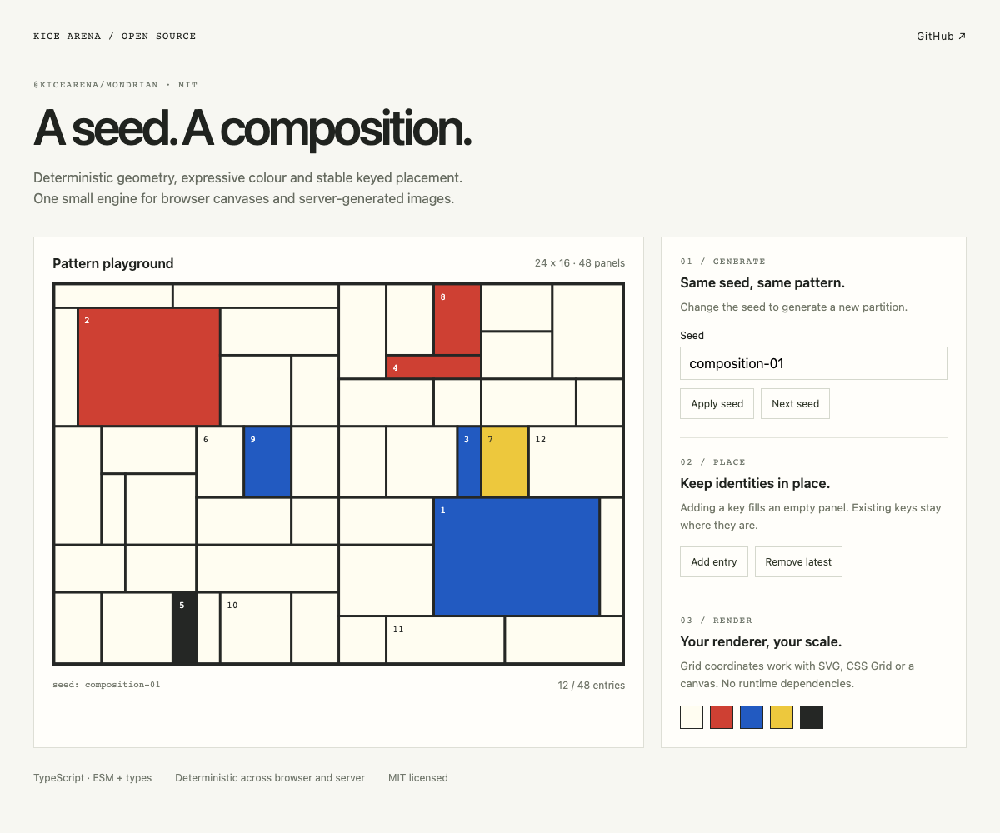

# @kicearena/mondrian

A tiny TypeScript engine for deterministic Mondrian compositions and stable keyed placement.

[](LICENSE)
[](https://github.com/kicearena/mondrian/pkgs/npm/mondrian)



## What can it do?

- **Generate** — 48 non-overlapping panels in a 24 × 16 grid from any string seed.
- **Place** — add and remove keyed entries while keeping retained entries in their panels.
- **Colour** — deterministic paper, red, blue, yellow and black tones.

No runtime dependencies. Use the same geometry in CSS Grid, SVG, canvas or server-generated images.

## Try the showcase

The [interactive demo](docs/demo.md) uses the real package with synthetic data. Clone this repository, then run:

```sh
bun install --frozen-lockfile
bun run demo
```

`bun run demo:build` creates a static site in `demo-dist/`. [Browse the editable example](demo/) or [read the API and integration guide](docs/api.md).

## Install

Published on **GitHub Packages**. This registry requires authentication even for public packages. Set a `read:packages` token in `NODE_AUTH_TOKEN` and add this project `.npmrc` (never store the token itself):

```ini
@kicearena:registry=https://npm.pkg.github.com
//npm.pkg.github.com/:_authToken=${NODE_AUTH_TOKEN}
```

```sh
bun add --exact @kicearena/mondrian@0.1.2
```

```ts
import {
  generateMondrianPattern,
  placeMondrianAttempts,
  mondrianAttemptTone,
} from "@kicearena/mondrian";

const seed = "composition-01";
const panels = generateMondrianPattern(seed);
const placements = placeMondrianAttempts(
  seed,
  [{ key: "item-1" }],
  new Map(),
  panels,
);
const panel = panels[placements.get("item-1")!];
const tone = mondrianAttemptTone(seed, "item-1", panel);
// Render panel.x, panel.y, panel.width and panel.height at your preferred scale.
```

Entry keys must be unique and stable, with at most 48 entries. Reuse previous placements only with the same seed and panels.

## Develop

```sh
bun run check
bun run test
bun run build
bun run demo:build
```

ESM and TypeScript declarations are included. 9 unit tests cover determinism, complete canvas coverage, placement retention and colours. Release a new exact version with a matching `v<version>` tag; published tarballs are immutable.

## License

[MIT](LICENSE) © 2026 KICE Arena contributors. Dependencies retain their respective licenses.
